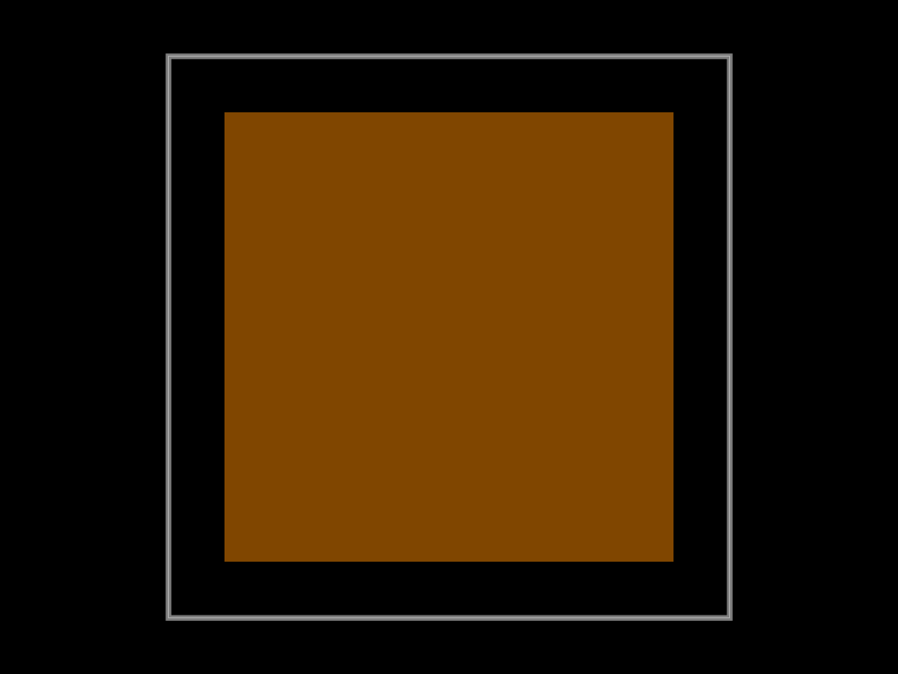
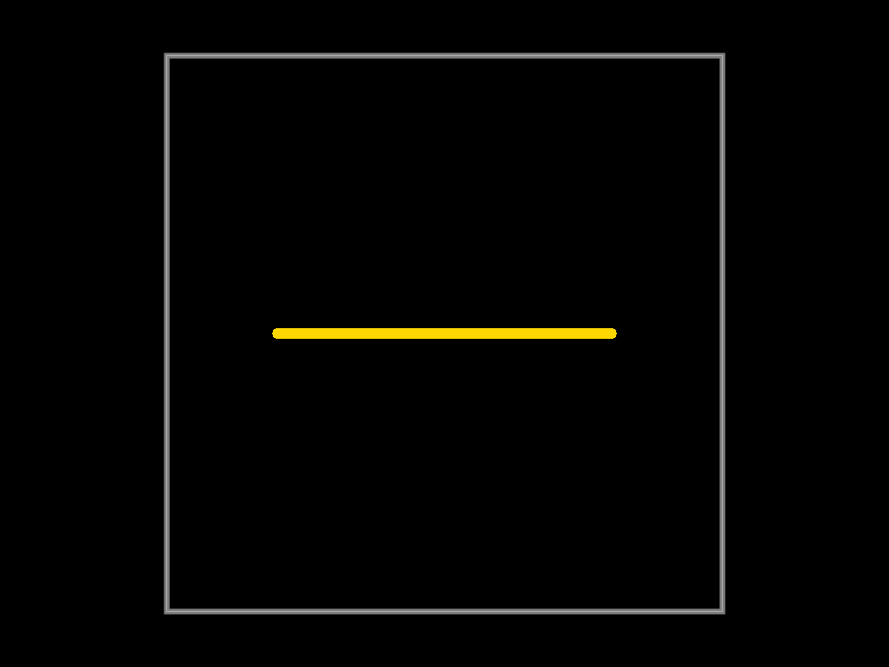
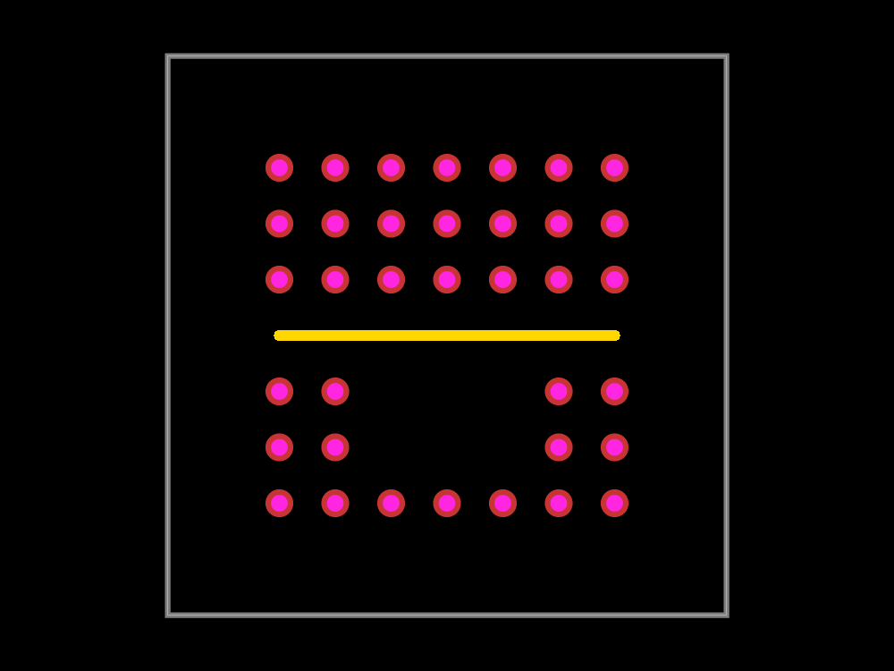
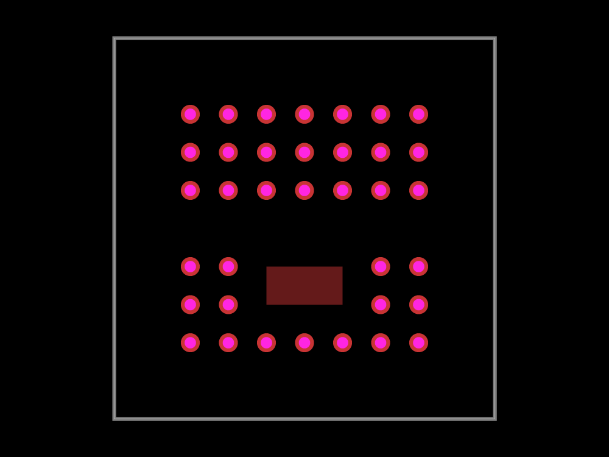

# Four-layer stitching reproduction

A generated 10 mm board has GND pours on inner1 and bottom, a foreign top
power pour, and a foreign inner2 signal. Default stitching returns no vias
because it only considers top/bottom pours. With top/bottom GND instead, the
same implementation emits two-layer records and ignores the inner copper.

The new regression intentionally fails on the reproduction branch. It requires
nonzero full-stack 0.30/0.50 mm vias, clearance from the signal and power copper,
and unchanged input. Images below show the original input; zero stitching is
the defect, not an accepted fabrication result.

Run `bun scripts/measure-four-layer-stitching.ts <checkout> <report.json>` for
paired measurements on the same generated inner-plane, outer-plane and
unchanged two-layer control cases. The report records span/contact failures,
input immutability, output hashes and ten measured timings after two warmups.
Benchmark results will be posted on each PR before merge; no board speedup is
inferred from these small cases.

## Fix and local comparison

Board-stack layers determine the through barrel; all eligible same-net pour
pairs are considered. Every traversed layer contributes trace and foreign-pour
clearance checks. Explicit pour-layer selection does not create blind vias.
Existing and new via separation includes copper clearance.

| Generated case | Vias, base → fix | Wrong span | Signal/pour contacts | Median ms |
| --- | --- | --- | --- | --- |
| inner-plane-pair | 0 → 36 | 0 → 0 | 0/0 → 0/0 | 0.020 → 11.620 |
| outer-pair-inner-copper | 49 → 36 | 49 → 0 | 7/6 → 0/0 | 0.776 → 3.591 |
| two-layer-control | 49 → 49 | 0 → 0 | 0/0 → 0/0 | 0.420 → 0.439 |

Bun 1.4.0, ten measured trials after two warmups, shared 4-vCPU Linux host
while three unrelated native board searches ran. All inputs are unchanged and
SHA256-identical between revisions. Both revisions finish all three cases,
but baseline's inner case emits zero vias and its outer case has unsafe copper
contacts. The two-layer control output is byte-identical (49 vias). Safety
checks add work; these tiny timings do not establish whole-board speedup.

With the repository's declared dependencies, the reproduction passes all ten
existing tests and fails the added regression. The fix passes all eleven tests
(895 assertions), with no functional assertions weakened. Six updated visual
snapshots were inspected; trace and foreign-pour keepouts remove unsafe sites.
The Blacksmith workflow repeats the same paired safety/geometry comparison on
every PR and uploads the raw timings and hashes. Hosted comparison [40219107299](https://github.com/tscircuit/via-stitch-solver/actions/runs/40219107299) is green. On Blacksmith 8-vCPU ARM / Bun 1.4.0, medians (base → fix) are 0.030 → 5.548 ms for the inner pair, 1.123 → 3.303 ms for the outer pair with foreign copper, and 0.629 → 0.714 ms for the unchanged two-layer control. All three cases finish, all input hashes match, the fixed four-layer outputs have zero span/contact findings, and the control output hash is identical. The raw hosted reports are alongside this document. Full unit CI [40219107257](https://github.com/tscircuit/via-stitch-solver/actions/runs/40219107257) also passes.
